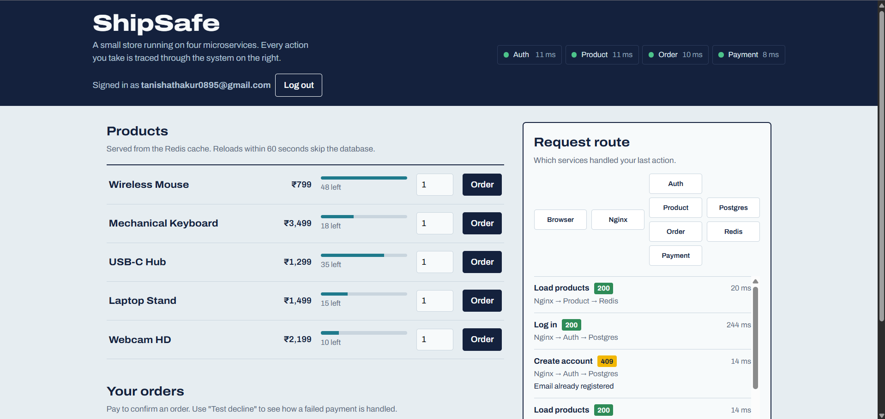
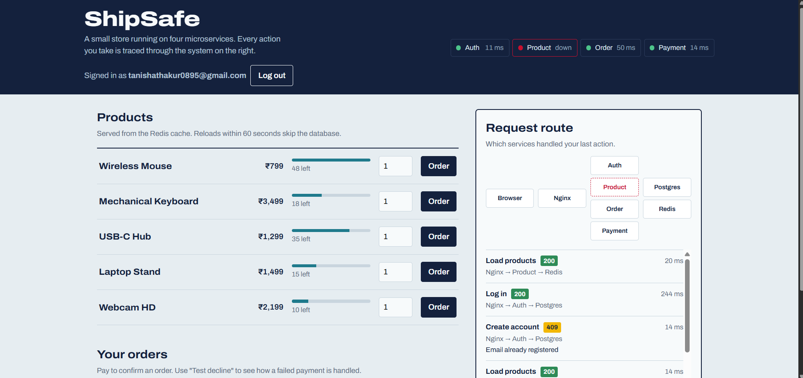

# ShipSafe

A microservices e-commerce app used as the base for a production-grade **CI/CD + GitOps** pipeline (Docker, Jenkins, Kubernetes, Helm, Argo CD, Argo Rollouts).

The store itself is simple on purpose. The point of the project is everything around it: how code gets tested, packaged, deployed, monitored and rolled back safely.



## Architecture

```
Browser ──► Nginx gateway (:8080)
              ├── /api/auth/     ──► Auth service      ──► Postgres
              ├── /api/product/  ──► Product service   ──► Redis cache ──► Postgres
              ├── /api/order/    ──► Order service     ──► Auth, Product, Postgres
              └── /api/payment/  ──► Payment service   ──► Order, Product, Postgres
```

| Service | Responsibility |
|---|---|
| **frontend** | Nginx serving the web UI and acting as a reverse proxy (the same job a Kubernetes Ingress does) |
| **auth** | Register, login, JWT tokens, bcrypt password hashing |
| **product** | Product catalogue with Redis caching and cache invalidation |
| **order** | Creates orders after verifying the user (via Auth) and stock (via Product) |
| **payment** | Mock payments: reserves stock and marks orders as paid or failed |
| **postgres** | Persistent data (Docker volume) |
| **redis** | Cache for the product list |

## Engineering highlights

- **Production Dockerfiles:** multi-stage builds, non-root users, `HEALTHCHECK` in every image, `.dockerignore`
- **Service-to-service calls** using Docker DNS names (`http://auth:8000`), the same model Kubernetes uses
- **Internal API key** protects endpoints that only other services may call (stock reservation, order status)
- **Row-level locking** (`SELECT ... FOR UPDATE`) so two payments can't oversell the last item
- **Graceful failure:** if a dependency is down, callers return a clear `503` instead of crashing
- **Startup ordering** with `depends_on: condition: service_healthy`
- **Secrets kept out of Git:** `.env` is ignored; `.env.example` documents what's needed
- **Live observability in the UI:** a health strip polls every service every 5 seconds, and a route map traces which services handled each request, highlighting the failing hop in red

## Run it locally

Requirements: Docker with Docker Compose.

```bash
git clone https://github.com/Tanisha0895/shipsafe-app.git
cd shipsafe-app
cp .env.example .env        # then change the secrets
docker compose up -d --build
docker compose ps           # wait until everything is healthy
```

Open **http://localhost:8080**, create an account, place an order and pay for it.

## Try a failure

```bash
docker compose stop product
```

The Product health chip turns red within 5 seconds. Placing an order now returns `503`, and the route map stops at Product.



Bring it back with:

```bash
docker compose start product
```

## API quick reference

All routes are available through the gateway at `http://localhost:8080/api/<service>/...`.

| Method | Path | Notes |
|---|---|---|
| POST | `/api/auth/register` | `{ "email", "password" }` |
| POST | `/api/auth/login` | Returns a JWT |
| GET | `/api/auth/me` | Requires `Authorization: Bearer <token>` |
| GET | `/api/product/products` | Response says whether it came from `cache` or `database` |
| POST | `/api/order/orders` | `{ "product_id", "quantity" }`, requires token |
| GET | `/api/order/orders` | Your orders, requires token |
| POST | `/api/payment/payments` | `{ "order_id", "simulate_failure": false }`, requires token |

Each service also exposes `/health` and interactive docs at `/docs` (e.g. http://localhost:8001/docs for Auth).

## Design trade-offs

- All services share one Postgres instance (separate tables) to keep the stack light on an 8 GB laptop. In production, each service would usually own its own database.
- Payments are mocked; `simulate_failure` forces a card decline for testing.

## Roadmap

- [x] **Phase 1:** Microservices app with Docker Compose
- [ ] **Phase 2:** Jenkins pipeline: tests, SonarQube quality gate, Trivy image scan, push to registry
- [ ] **Phase 3:** Kubernetes (kind) with Helm charts and Ingress
- [ ] **Phase 4:** GitOps with Argo CD
- [ ] **Phase 5:** Canary releases with Argo Rollouts and Prometheus-based automatic rollback
